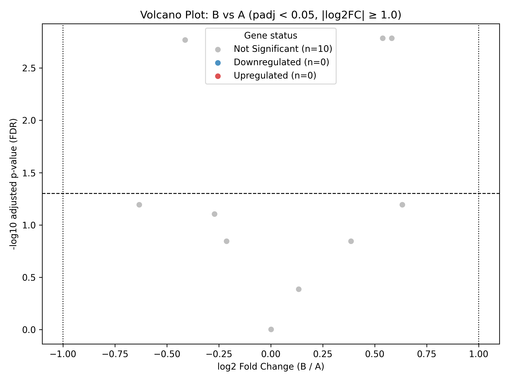

# Bulk RNA-Seq Differential Gene Expression & Transcriptomics Pipeline

An end-to-end differential gene expression (DGE) analysis pipeline built in Python (`PyDESeq2`, `Pandas`, `NumPy`, `Matplotlib`, `Seaborn`) to identify statistically significant transcriptional changes between experimental cohorts.

## Pipeline Overview & Key Steps

1. **Count Matrix Validation & Quality Control:**
   - Verified sample-metadata index alignment, non-negative integer read counts, and explicit categorical reference-level encoding (`Condition B` vs. `Reference A`).
   - Filtered low-expression noise ($\sum \text{counts} \ge 10$ across samples) prior to statistical dispersion modeling.

2. **Negative Binomial Modeling & Wald Hypothesis Testing (`PyDESeq2`):**
   - Estimated median-of-ratios size factors, gene-wise dispersion shrinkage, and $\log_2$ fold changes via `DeseqDataSet` and `DeseqStats`.
   - Applied Benjamini-Hochberg False Discovery Rate (FDR) correction to classify **Upregulated** ($\text{padj} < 0.05, \log_2\text{FC} \ge 1.0$) and **Downregulated** ($\text{padj} < 0.05, \log_2\text{FC} \le -1.0$) genes while preserving full test tables.

3. **Transcriptomic Data Visualization:**
   - **Volcano Plot (`rnaseq_volcano_plot.png`):** Visualized statistical significance ($-\log_{10}\text{padj}$) against expression magnitude ($\log_2\text{FC}$) and annotated top differentially expressed hits.
   - **Clustered Expression Heatmap (`rnaseq_top_deg_heatmap.png`):** Computed row-wise Z-scores on $\log_2$-transformed normalized counts (`dds.layers["normed_counts"]`) to hierarchically cluster top differentially expressed genes across sample conditions.

## Repository Deliverables
* `RNA_Seq_Differential_Expression.ipynb` — Complete executable Google Colab / Jupyter notebook
* `deseq2_differential_expression_results.csv` — Full Wald test statistics (`baseMean`, `log2FoldChange`, `pvalue`, `padj`, `Regulation`)
* `rnaseq_volcano_plot.png` — 300-DPI Volcano Plot
* `rnaseq_top_deg_heatmap.png` — 300-DPI Hierarchically Clustered DEG Heatmap

